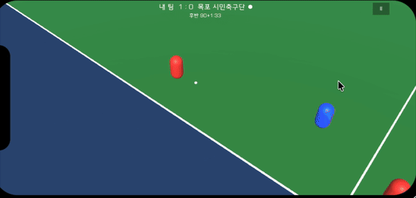
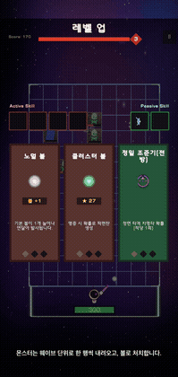
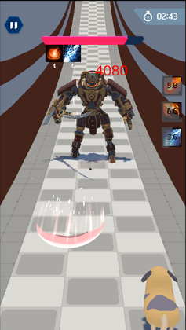
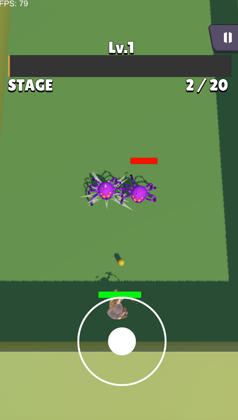

같은 작업을 두 번 하게 되면 세 번째는 없게 만드는 Unity 클라이언트 개발자입니다. 
반복은 에디터 도구와 템플릿으로 없앱니다. 게임 규칙은 순수 C#으로 분리해 테스트로 검증하고, 성능은 측정한 수치로 고칩니다.

## 지금 만드는 것

<table>
  <tr>
    <td align="center" width="55%">
      
    </td>
    <td width="45%" valign="top">
      <b>PitchSimulator</b> · 11대11 축구 시뮬레이터 (2026.09 ~, 개인 · Android 출시 준비 중)  
      킥오프 전에 선수 11명의 능력치·전술 지시·배치를 세팅하고, 개입 없이 관전해서 이기는 게임입니다.  
      · 22명이 같은 행동 트리를 쓰고 역할은 지시 수치만 다릅니다 
      · 경기는 고정 스텝의 순수 C#으로 돌아 같은 시드면 어느 기기에서도 결과가 같습니다 
      · 자동 대전 300판을 10초에 돌려 규칙 하나를 바꿀 때마다 골 수·무승부율을 수치로 봅니다 
      · EditMode 테스트 329개, 4부 리그·승강전·스카우트  
      <a href="https://github.com/pmj9384/PitchSimulator">코드</a> · <a href="https://pmj9384.tistory.com">개발일지</a>
    </td>
  </tr>
</table>

## 만든 것

<table>
  <tr>
    <td align="center" width="33%">
       
      <b>Cosmo Defence</b> 
      핀볼 디펜스 · 2026.06 ~ 07 · 개인 
      순수 C# 코어 + EditMode 테스트 56개 CI 오브젝트 풀로 32.9ms → 11.9ms Addressables 선로딩 303.7ms → 46.8ms 
      <a href="https://github.com/pmj9384/CosmoDefence">코드</a>
    </td>
    <td align="center" width="33%">
       
      <b>Animal Break Out</b> 
      3D 러너 · 2025.03 ~ 05 · 6인 팀 · Google Play 출시 
      플레이어 조작(New Input System)·상태 관리 Addressables 씬 분할 로딩 Unity Localization 다국어 · 디버그 툴 
      <a href="https://github.com/pmj9384/Unity-AnimalBreakOut">코드</a>
    </td>
    <td align="center" width="33%">
       
      <b>Archer Legend</b> 
      스테이지형 슈팅 · 2025.01 ~ 02 · 개발 1인 · 기획 1인 
      보스·스킬 시스템, 슬롯머신 스킬 선택 UI 몬스터 FSM · 오브젝트 풀 · 로컬 세이브 
      <a href="https://github.com/pmj9384/UnityMiniProjArcher">코드</a>
    </td>
  </tr>
</table>

<b>Timing Bridge</b> · 하이퍼캐주얼 아케이드 · 2026.01 ~ 04 · 개인 · AdMob 리워드 광고 · AAB 빌드 · Google Play 심사 제출 · <a href="https://github.com/pmj9384/TimingBridge">코드</a>

## 기술

  

## 경력·활동

- **경일게임아카데미** · 기업 맞춤형 유니티 엔진 기반 모바일게임 개발자 양성 과정 (2024.09 ~ 2025.05)
- **세명대학교 Unity 게임 개발 동아리** · 부장 (2023.03 ~ 2024.12)
- **세명대학교 졸업작품 ARLabel** · 팀장 · 캡스톤디자인 경진대회 장려상 (2023.09 ~ 2024.06)
  - Unity AR Foundation으로 마커를 인식해 제품 광고 영상·영양 정보를 띄우는 무라벨 제품 정보 시스템 (Spring Boot API 연동)
  - 논문 제1저자: 「AR기반의 무라벨 상품용 효과적인 홍보 애플리케이션의 연구」, 스마트융합콘텐츠 논문지(KCI), 2024.06

  

